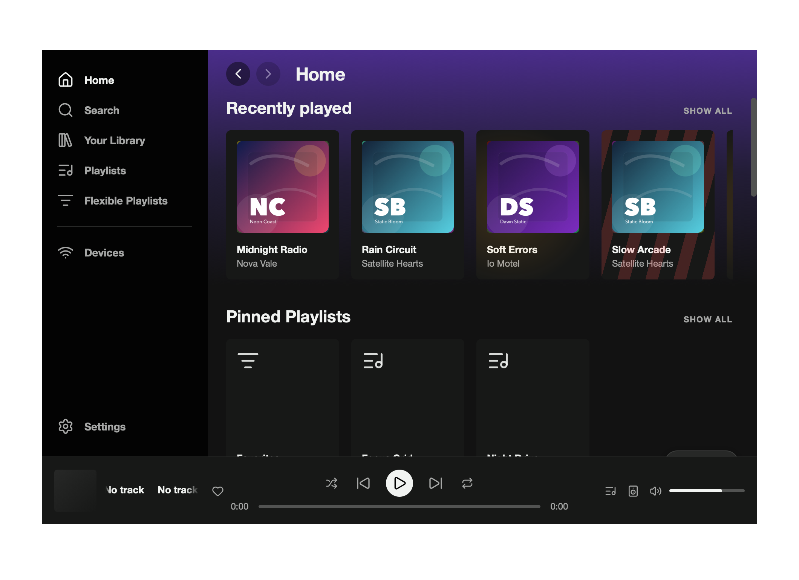
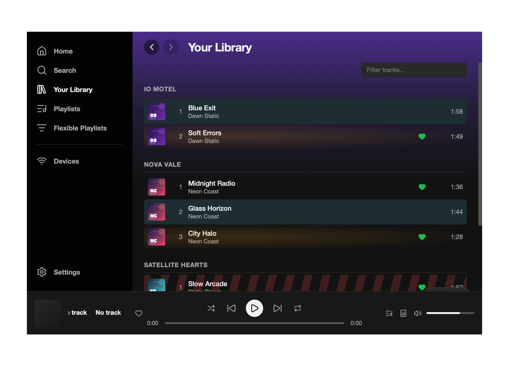
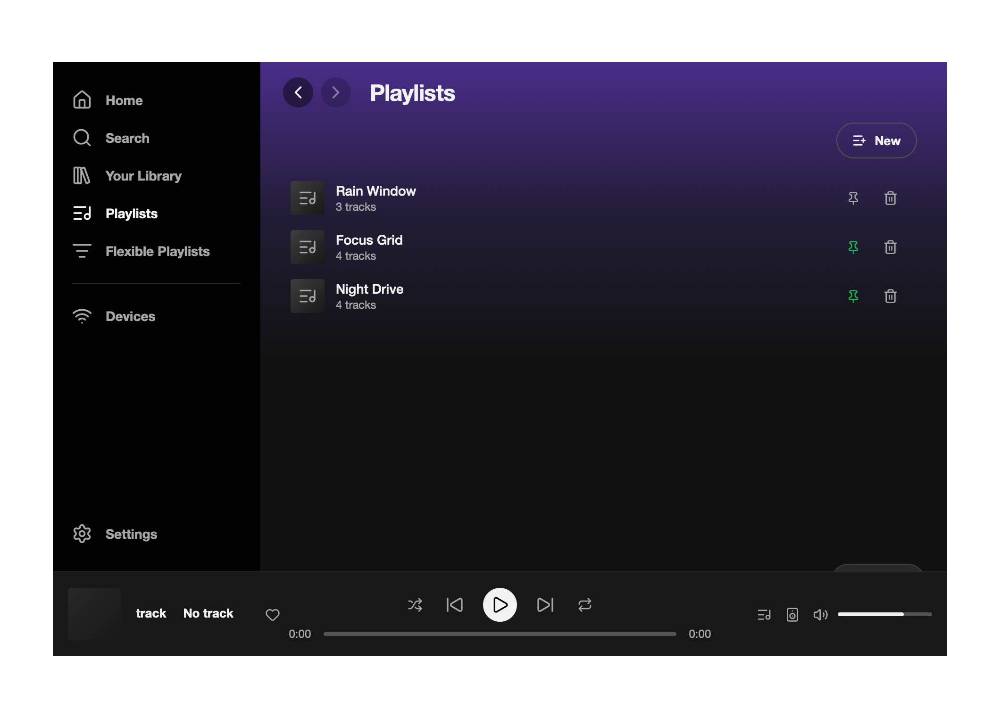
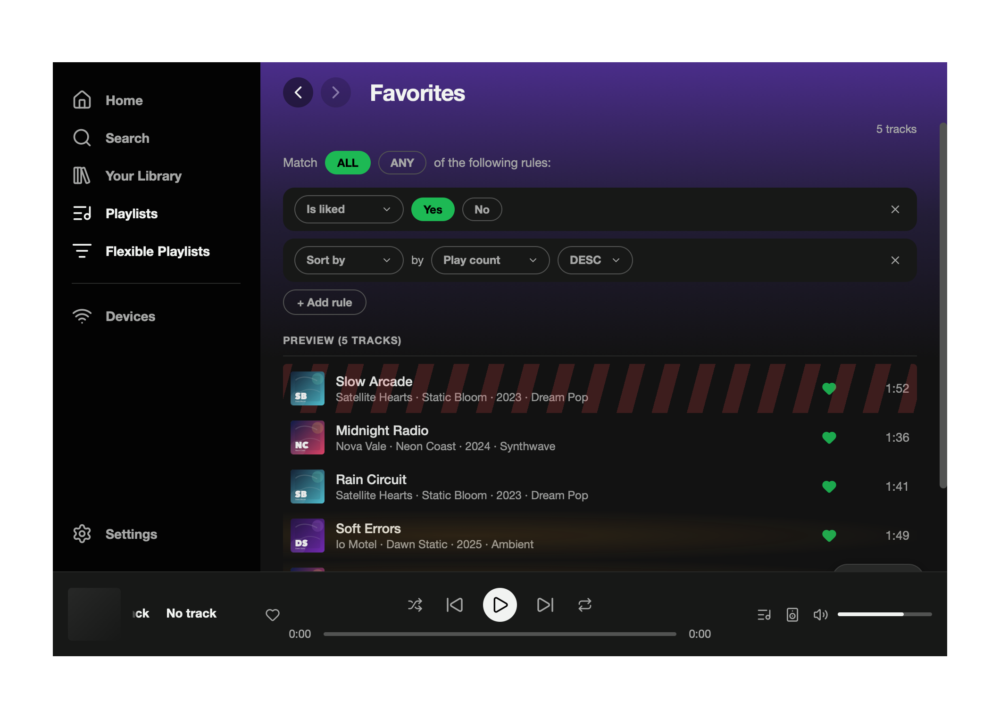
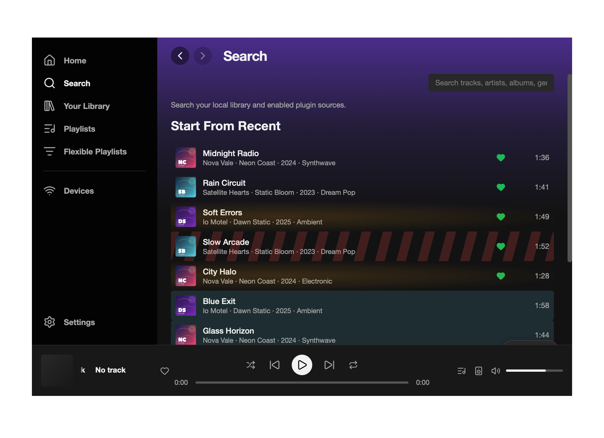
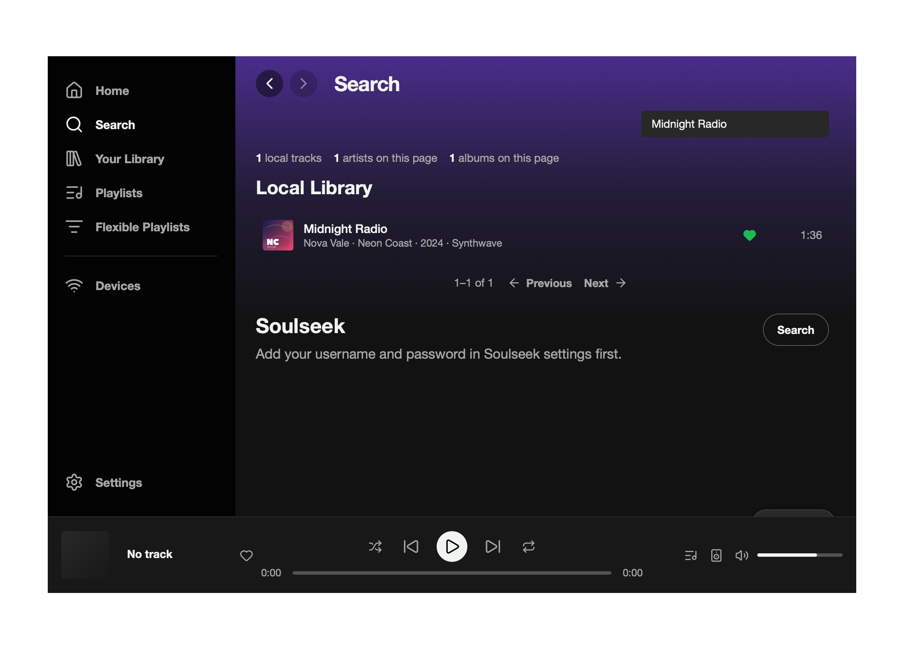
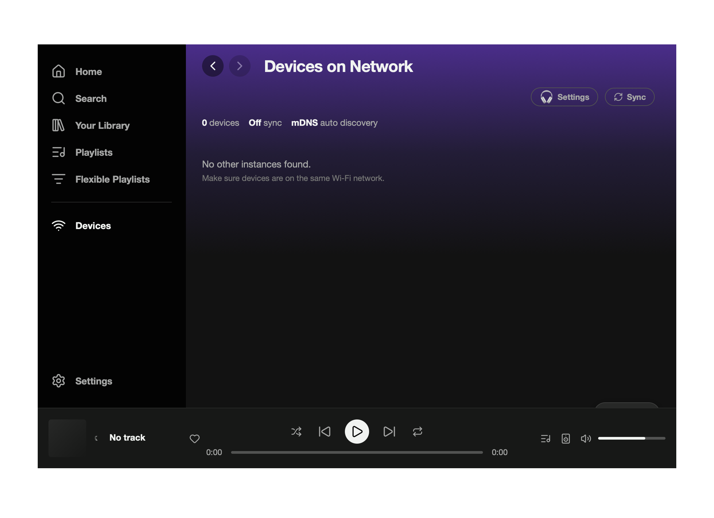

# Player
<p>
  

  <br><br><br>

  <p style="max-width:300px;"><b>Player</b> is a local-first music player built with
  Vue 3, TypeScript, Tauri 2, and Rust.</P>

  <br><br><br>
</p>

<br clear="right">

It is designed for people who keep a real music library on **disk** and want **fast local playback**, **metadata editing**, **playlists**, cross-device **sync on a local network**, and a native-feeling app on both desktop and Android.

This project is not a cloud streaming service! The filesystem is the source of truth, the app database is a fast local index, and sync is optimized for peer-to-peer usage inside your own network.

## Download

<p align="center">
  <a href="https://github.com/NoName-Audio/player/releases/latest/download/player-macos-universal.dmg">
    
  </a>
  &nbsp;
  <a href="https://github.com/NoName-Audio/player/releases/latest/download/player-windows-x64-setup.exe">
    
  </a>
  &nbsp;
  <a href="https://github.com/NoName-Audio/player/releases/latest/download/player-linux-x86_64.AppImage">
    
  </a>
  &nbsp;
  <a href="https://github.com/NoName-Audio/player/releases/latest/download/player-android-universal.apk">
    
  </a>
</p>

<p align="center">
  <sub>Direct downloads from the latest GitHub release · <a href="https://github.com/NoName-Audio/player/releases/latest">release notes and all packages</a></sub>
</p>

## Overview

Player focuses on a few core jobs:

- Index a local music library and keep it in sync with the filesystem.
  Repeated scans preserve track IDs and only count newly discovered files as additions; unchanged audio and CUE albums are skipped.
- Play audio through a native Rust backend with low-latency controls.
- Browse by artist and album, and store and edit metadata, likes, history, and playlists.
- Build smart playlists from filter rules.
- Discover your other devices on the LAN, sync files and metadata with them, and hand playback over to them.
- Find, preview, and download music from Soulseek.
- Provide a richer now-playing experience with beat-reactive visuals and a WebGL album card.

## Screenshots

These screenshots were captured with the built-in demo mode. Click any image to open the full-size version.

<table>
	<tr>
		<td width="50%" align="center">
			<a href="./readme/first.png">
				
			</a>
			<br />
			<sub>Home with recently played and pinned playlists</sub>
		</td>
		<td width="50%" align="center">
			<a href="./readme/library.png">
				
			</a>
			<br />
			<sub>Library grouped by artist with rich track rows</sub>
		</td>
	</tr>
	<tr>
		<td width="50%" align="center">
			<a href="./readme/playlists.png">
				
			</a>
			<br />
			<sub>Regular playlists</sub>
		</td>
		<td width="50%" align="center">
			<a href="./readme/flexible-playlist-edit.png">
				
			</a>
			<br />
			<sub>Flexible playlist editor with rule-based filters</sub>
		</td>
	</tr>
	<tr>
		<td width="50%" align="center">
			<a href="./readme/search.png">
				
			</a>
			<br />
			<sub>Search starting state with recent listening context</sub>
		</td>
		<td width="50%" align="center">
			<a href="./readme/soulseek-search.png">
				
			</a>
			<br />
			<sub>Soulseek search awaiting account configuration (no network results)</sub>
		</td>
	</tr>
	<tr>
		<td colspan="2" align="center">
			<a href="./readme/devices.png">
				
			</a>
			<br />
			<sub>Devices and sync view</sub>
		</td>
	</tr>
</table>

## Current Features

### Library

- Recursive local library indexing, kept up to date by a filesystem watcher.
- Metadata from audio tags, with folder-structure and filename fallbacks.
- CUE sheet support: each segment of a single-file album is its own track.
- Artist and album pages, including compilations and guest appearances, with full-size album covers.
- Cover art from embedded tags or sidecar images (`cover.jpg`, `folder.jpg`, ...), stored once per album as small resized copies.
- Track editing and identification through AcoustID fingerprints.
- Likes, play counts, history, and recent tracks.
- Duplicate detection: flags duplicates without deleting anything.
- Drag files or folders anywhere onto the app window to import music. A window-wide drop target appears while dragging; imports copy into the library without moving originals, with progress shown in Activity.

On Android, native library scans use a separate **Library indexing** foreground
notification and a partial wake lock while at least one scan is active; playback
uses its own service. Discovery shows indeterminate progress, followed by file
counts. Tapping the notification opens Player. Starting a scan must be permitted
by Android's foreground-service rules: a background start can be rejected, in
which case indexing reports a failure rather than running without protection.
Android 15+ also limits the app's total background `dataSync` service time. On a
timeout the notification and wake lock are removed immediately, and the native
scan cancels at its next progress checkpoint (an in-flight file may finish first).
Force-stop, process death, device power policy, and denied notifications can still
interrupt or hide this work; the service is not automatically restarted. Reopen
Player and explicitly reindex to resume; already committed unchanged files are
skipped. Merely reopening an existing library does not automatically resume an
interrupted scan.
On Android 13+, the first scan started while Player is visible requests notification
permission once. Denial does not prevent foreground indexing, but Android may hide
its notification from the notification drawer; enable notifications in system app
settings to restore visibility. A scan started before the activity is visible
does not open a permission prompt from the background.

### Playback

- Native audio decoding and playback in Rust, for FLAC, MP3, Ogg Vorbis, Opus, WAV, and AAC/ALAC.
- Opus playback through bundled libopus, including mono and stereo Opus in MP4 containers.
- Local MP4, M4V, and WebM video appears behind the playback controls. Now Playing fills the app window with uncropped video, without album art or beat-reactive blur. Hover over the bottom controls, use keyboard focus, or tap the video to reveal playback controls. Hover over the top-right corner to reveal the close button; tapping the video or focusing the button also reveals it. Swiping down closes the view. Video follows native audio and requires WebView codec support.
- Seek, pause, resume, stop, and volume control.
- Output device and sample rate selection.
- Queue with shuffle, repeat, and up-next, across lists of any length.
- Beat detection and real-time audio spectrum above the controls footer, shared with the detail visuals; hidden while paused, seeking, in background tabs, or with reduced motion.

### Organization

- Regular playlists and smart playlists driven by filter rules, with pinning to the home screen.
- Fast paged library and search, so large libraries stay responsive.
- Playing a pinned regular or smart playlist from Home, including a preview row, continues through the full playlist by fetching queue pages as needed rather than stopping at the preview or loading every track upfront.
- Reveal a track's file in the file manager, or share it (Android).

### Sync, discovery, and remote playback

- Peer discovery over mDNS.
- Local network sync of files, metadata, playlists, and history between devices.
- Merkle-style reconciliation, so a sync only transfers what changed.
- File sync verifies physical BLAKE3 identities before saving or registering media; CUE segment identities remain separate and are reconstructed by the normal CUE indexer. Invalid or unverifiable transfers are reported as failures, not accepted as new tracks. CUE transfers from older peers without physical source identities require upgrading the sending device.
- Physical-identity verification runs in the background and reports through the existing library indexing progress. Startup only prepares a database-backed repair queue; it does not read every audio file before the app opens. Verification is durable and resumable per physical file, so completed files do not need to be rehashed after a restart, even when their modification time is unchanged.
- Legacy physical tracks and CUE segments are withheld from sync until their source file has been verified. Failed files remain withheld; normal library indexing and filesystem-watch updates retry verification. An already completed `physical-file-hashes-v1` migration is honored rather than queuing the legacy library again. Verification does not modify media, remove existing duplicate files, or reset playlists, history, or edited metadata.
- Incoming file selection and its download-time recheck distinguish export quarantine from absence: verified local identities prevent duplicate downloads, while unresolved repairs defer only matching source paths (including matching filenames after peer folder reorganization) or verified physical source identities. Failed unrelated sources do not block other downloads. Legacy hashes alone never prove presence; after repair, the next sync can select genuinely missing tracks.
- Play on another device: hand the current track over to a peer and keep controlling it.
- IPv4/IPv6-friendly internal HTTP server. There's no authentication, so use it on networks you trust.

### Soulseek integration

- Search from inside the app, with cover previews.
- Streaming previews that start playing while the file downloads.
- Downloads straight into the library, organized as `Artist/Album/file`.
- Track replacement: swap a track's file for a better copy and keep its metadata, likes, and history.

### UI and platform

- Responsive desktop/mobile layout.
- Android media notification and lock-screen controls.
- Now-playing view with a Three.js/WebGL album card.
- Dark and light themes (or following the system) with a choice of accent color and header gradient.
- Settings page for library tools, audio output, device identity and sync, Soulseek, and appearance (theme, accent color, gradient, tint, reduced motion).
- Appearance includes independent **Footer live spectrum** and **Seek waveform** switches, both on by default and saved on this device. Disabling seek waveforms keeps ordinary played/unplayed seek progress and background waveform caching; reduced motion only pauses live/decorative visuals, not static seek waveforms.
- Seek progress moves smoothly between playback status updates without extra backend polling; pausing freezes it and seeking jumps directly to the selected position.
- Footer track titles and artists scroll independently only when they exceed their available width, travelling just far enough to reveal the end before returning. Fitting text stays still; reduced motion disables this scrolling, and artist names remain clickable.
- Optional Discord Rich Presence on desktop, off by default.
- About section with version info, update checks, an embedded changelog, contributors, and third-party licenses. Release notes preserve Markdown paragraph, heading, and nested-list spacing; long code blocks scroll within the notes.
- Demo mode with a seeded library (`--demo`), used for the screenshots above.
- Seek bars use cached audio waveforms: indexing analyzes local audio into 256 absolute RMS-amplitude bins (mean energy across channels, without phase cancellation or per-bin normalization), persists them across restarts, and regenerates them when the source, track segment, or analysis algorithm changes. Existing libraries and older peak caches are backfilled in the background, prioritizing the selected track after the current source finishes. The player lazily requests only the selected track's cached waveform and refreshes it when analysis finishes; pending or unsupported waveforms show a neutral progress line instead. Narrow seek bars combine bins by mean energy to keep visible gaps between bars. Desktop, mobile, and track detail views support click/drag seeking and arrow keys, Home, and End; the visual is 19px high while mobile seek targets remain at least 44px.

### Debug SQL

Settings → Debug includes a SQL editor for the live indexing database. Run one
SQLite statement at a time; read-only statements run immediately, while writes
(including `UPDATE`, `DELETE`, and schema changes) require explicit confirmation.
Changes commit atomically and refresh library views without automatically
reindexing or undoing the edits. Back up the database before destructive changes.

Execution has a five-second deadline, including waiting for the library database,
and returns at most 1,000 rows within a 4 MiB result budget. Truncated write results
still execute the entire statement; errors and timeouts roll the statement back.
SQL input is limited to 256 KiB and individual SQLite values to 4 MiB. Blobs are
shown as base64 objects; integers outside JavaScript's safe range are strings.
This is a trusted local tool, not a plugin permission. Explicit transactions,
attached databases, virtual-table creation, extension/file functions, and unsafe
PRAGMAs are blocked. Schema-introspection PRAGMAs remain available.

## Desktop updates

Windows, macOS, and Linux releases use the signed Tauri Updater flow. Release builds publish
platform updater bundles, their `.sig` files, and a generated `latest.json` manifest to GitHub
Releases. Android uses its native APK updater instead of the desktop Tauri updater.
In About, **Update now** downloads the APK with actual byte progress, verifies it, and opens
Android's package installer. If Android requests permission to install unknown apps, allow
Player and return to the app; installation resumes automatically. Downloading, verification,
permission, and installer hand-off are distinct states, not confirmation that an update was
installed. You can cancel a pending update or retry after an error. Returning to About or
recreating the screen restores the native update status without starting another download.
The release-page link remains available for manual downloads.
Only the latest stable official universal APK is accepted. Player streams it into private
cache, checks that its application ID matches, its Android version code is newer, and
its cryptographically verified signing certificates match the installed app before
opening the installer. Differently signed local/debug builds cannot update to a release
signed with another key. Partial and failed downloads are removed; Android may terminate
Player during replacement, so reopen it to confirm the new version.

APK plugins use a separate restricted FileProvider component from the general file-sharing
provider. This prevents Android from reusing the wrong provider for the catalog authority,
which can otherwise make the package installer report a package parsing error.

The updater public key is committed in `src-tauri/tauri.conf.json`. Keep the matching private
key outside the repository and back it up: losing it prevents shipping updates to existing
installations.

Before running the release workflow, configure this GitHub Actions secret:

```bash
gh secret set TAURI_SIGNING_PRIVATE_KEY < /path/to/player-updater.key
```

The current key has no password. If it is replaced with an encrypted key, also configure
`TAURI_SIGNING_PRIVATE_KEY_PASSWORD`. For a signed local bundle, run:

```bash
TAURI_SIGNING_PRIVATE_KEY=/path/to/player-updater.key \
TAURI_SIGNING_PRIVATE_KEY_PASSWORD='' \
pnpm tauri build
```

Repository API calls and release publishing use the workflow's built-in `GITHUB_TOKEN`.
The version workflow creates the tag and explicitly dispatches the release workflow;
it requires `contents: write` and `actions: write`. No personal `RELEASE_TOKEN` is required.

## Tech Stack

- Frontend: Vue 3, TypeScript, Vite.
- Desktop/mobile shell: Tauri 2.
- Backend: Rust.
- Audio decode: Symphonia with bundled libopus for Opus.
- Audio output: CPAL.
- Metadata extraction: lofty.
- Cover resizing: image.
- Local database: SQLite via rusqlite.
- File watching: notify.
- LAN discovery: mdns-sd.
- Sync transport: tiny_http + reqwest.
- Optional Soulseek plugin: own vendored soulseek-rs client in player-plugins.
- Audio identification: rusty-chromaprint + AcoustID.
- 3D visuals: Three.js.
- Icons: Lucide.
- Optional Discord plugin: owns its discord-rich-presence dependency in player-plugins.
- Logging and profiling: tracing, optional Tracy.

## Architecture at a glance

The project is split across a few runtime boundaries:

- Vue owns screen state, queue behavior, interaction flow, and visual presentation.
- Rust owns playback, indexing, persistence, sync, discovery, and native integration.
- Android-specific code owns OS-facing media session and notification behavior.

Main source files:

- `src/App.vue`: the application shell: navigation, queue, and playback coordination.
- `src/components/`: extracted UI, such as the player bar, track rows, artist and album pages, the settings page, and the WebGL album card.
- `src-tauri/src/lib.rs`: Tauri bootstrap and command registration.
- `src-tauri/src/library.rs`: library index, metadata, playlists, history, duplicates.
- `src-tauri/src/covers.rs`: cover store, served to the UI over a `cover://` URL scheme.
- `src-tauri/src/playback.rs`: playback engine, beat detection, spectrum.
- `src-tauri/src/audio_codecs.rs`: the codecs playback decodes with, including Opus through libopus.
- `src-tauri/src/discovery.rs`: peer discovery.
- `src-tauri/src/sync.rs`: sync protocol, peer HTTP server, remote playback.
- `src-tauri/src/plugins/`: generic native plugin host; Soulseek and Discord are separate installable packages.

For a deeper architecture write-up, see [DESIGN.md](./DESIGN.md).

## Development

### Prerequisites

- Node.js 20+.
- pnpm.
- Rust toolchain.
- CMake and a C/C++ toolchain, to compile the bundled libopus.
- Tauri system dependencies for your platform. On Linux: webkit2gtk-4.1, ALSA (libasound), libappindicator3, and librsvg2.
- Android SDK/NDK if you want Android builds.

### Install

Plugin sources come from [player-plugins](https://github.com/NoName-Audio/player-plugins),
pinned as the `plugins/` git submodule. Initialize it before building or running tests:

```bash
git submodule update --init -- plugins
pnpm install
```

### Run in development

```bash
pnpm tauri dev
```

### Plaintext plugin credentials (desktop opt-in)

By default plugin secrets use OS credential storage. To keep **all plugin secrets
in an unencrypted plaintext JSON file instead**, launch with an explicit path:

```bash
pnpm tauri dev -- -- --credentials-file /tmp/player-test-credentials.json
```

Relative paths are resolved against the app's working directory. The desktop
executable also accepts `--credentials-file <path>` directly. No environment
variable enables this mode. Missing or duplicate paths stop startup with an error.
File mode never reads or migrates OS credentials; existing caches retain their
normal plugin activation/reset behavior. An initially empty file therefore needs
the Soulseek password entered again in the UI. The username remains in normal
plugin settings, not this file.

**Warning:** anyone who can read this file can read the passwords. Do not commit,
share, or back it up insecurely. On Unix, newly created directories are private
(`0700`) and files are forced to `0600` or access fails. Symlink and non-regular
credential files are rejected, malformed JSON fails closed, and saves use atomic
replacement. Existing OS credentials remain unchanged when this flag is omitted.

### Run in demo mode

Demo mode uses a separate, seeded library and doesn't touch your own:

```bash
pnpm tauri dev -- -- --demo
```

### Check and test

```bash
pnpm build                 # refresh licenses and contributors, frontend typecheck and bundle
pnpm test:licenses         # tests for the build scripts
pnpm test:contributors
cd src-tauri && cargo test # Rust tests
```

### App icons

`public/app-icon.svg` is the unchanged original transparent logo, also used by
About and the browser favicon. With ImageMagick 7 (`magick`) and the project's
pnpm dependencies installed, regenerate desktop, iOS, and Android assets with:

```bash
pnpm icons:generate
```

The script invokes Tauri directly (without version synchronization), preserving
desktop PNG/ICO/ICNS alpha and iOS's required opaque white background. It then
regenerates Android resources in `src-tauri/gen/android/app/src/main/res/` with
an opaque graphite background (`#20242C`) and centered cyan/purple artwork: the adaptive foreground fits a
46dp square inside the central 66dp safe circle of the 108dp canvas. Legacy and
round launchers also have padding, and hdpi launchers are correctly 72px. Both
adaptive launcher XML variants and the manifest round-icon reference are kept
in sync. Run this command rather than bare `tauri icon`, which overwrites these
Android corrections. The Android project must already exist.

On macOS, the running application explicitly uses the transparent PNG via
AppKit's `NSApplication.applicationIconImage`, keeping the Dock artwork consistent
between development and bundled releases without adding an opaque tile. This
does not override Finder or Spotlight: macOS Tahoe may add its own backing to
legacy `.icns` bundle icons even when their pixels are transparent. A native
Icon Composer asset requires a newer Apple toolchain and is not generated by
this script. Do not treat a transparent `.icns` preview as proof of Finder's
presentation, or modify the signed app bundle to apply a custom Finder icon.

Android uses an explicit graphite background for consistent contrast rather than
relying on a launcher's treatment of transparency. The foreground remains
transparent and retains adaptive support and safe-zone padding; legacy icons
use the same graphite background. Launchers can still choose masks, shadows,
and themed-icon treatments. Desktop artwork remains transparent.

### Profile library indexing with Tracy

Run the optimized, instrumented desktop build, then connect the Tracy Profiler
UI to `127.0.0.1`:

```bash
pnpm tauri:tracy
```

The `tracy` Cargo feature is disabled by default. Its client accepts local
connections only and starts collecting on demand. Trigger **Reindex** in the app
to capture directory walking, database lock waits, metadata and cover reads,
file hashing, SQLite writes, CUE indexing, stale cleanup, and watcher batches.

### Build desktop app

Native builds compile libopus from source (see Prerequisites), so no separate
Opus library is required on the user's device.

```bash
pnpm tauri build
```

#### Linux AppImage and Wayland

Release AppImages are built on Ubuntu 22.04. Their bundled copy of `libwayland-client`
is older than the Mesa drivers on current distributions such as Arch and Garuda, which
leaves the window grey and prints `Could not create default EGL display: EGL_BAD_PARAMETER`.
The release workflow therefore removes `libwayland-*` from the AppImage, so the system
libraries are used, and signs the repacked file again for the updater.

To check a downloaded AppImage, run it from a terminal and look for the EGL message.
If an older release is affected, start it with the system libraries:

```bash
LD_PRELOAD="/usr/lib/libwayland-client.so.0:/usr/lib/libwayland-egl.so.1" ./player-linux-x86_64.AppImage
```

The library paths differ between distributions.

Frontend builds refresh the About contributor list from GitHub and bundle their
avatars, so the credits also work offline. If GitHub is unavailable, the build
uses the saved snapshot in `src/generated/contributors.json` and
`public/generated/contributors/`. Keep these generated files in version control.

Run `pnpm contributors:sync` to refresh the snapshot separately. The script uses
`GITHUB_REPOSITORY` or the GitHub origin remote, and optionally accepts
`GITHUB_TOKEN` or `GH_TOKEN` for authenticated API requests. Release builds pass
the GitHub Actions token automatically. Tokens are never included in the credits
or sent when downloading avatars.

### Android

```bash
pnpm android:build
pnpm android:build-deploy
```
Native updater regression tests live in `SelfUpdaterTest`. Run them on an isolated emulator,
not a production device: the permission test opens Android settings and the package installer.
Pass instrumentation arguments `compatibleApk` and `foreignApk` pointing to readable test APKs
with application ID `dev.verncat.player` and a version code newer than the installed debug app.
Sign the former with the installed debug key and the latter with a different key. Set the
emulator's `REQUEST_INSTALL_PACKAGES` app-op to `deny` before the run; the permission-resume test
changes it to `allow` and exercises real content-URI hand-off without accepting installation.
The tests also reject malformed, same-version, wrong-package, wrong-signer and tampered APKs.
Run `ApkPluginsTest#catalogApkProviderResolvesAndStreamsPrivateDownload` alongside them for the
catalog-provider authority/streaming regression.

## Repository notes

- `plugins/soulseek/vendor/soulseek-rs-lib/` contains the protocol library used only by the independent Soulseek plugin.
- `src-tauri/vendor/symphonia-format-ogg/` is a patched copy of Symphonia's Ogg demuxer that fixes Opus gapless trimming; `PATCHES.md` there lists the changes.
- `src-tauri/gen/android/` contains generated Android project files produced for the Tauri mobile target.

## Status

This project is actively evolving. The architecture is intentionally pragmatic: some surfaces are already well-isolated, while others are still consolidated to keep product iteration fast.

If you want the full descriptive architecture document, read [DESIGN.md](./DESIGN.md).

### Plugin development

See [the plugin guide](https://github.com/NoName-Audio/player-plugins/blob/main/docs/README.md) for package installation, the SDK,
UI contributions, native capabilities and development workflows.

Installed package payloads are immutable, fingerprint-addressed files under the
plugin store's `packages/` directory. The registry stores only package references,
activation generations, settings, and secret-key names, so granting permissions or
changing settings does not rewrite bundled native runtimes. Existing inline-package
registries are migrated on load; the registry switches to references on its next
successful change, while its previous backup remains recoverable.

Native `.player-plugin` artifacts may include a `files` map of flat runtime filenames,
each containing base64 `data`, `sha256`, and an `executable` flag. The host verifies
the library and runtime hashes before enabling the plugin, and repairs modified files
before loading a new activation. Files live beside `plugin.<platform extension>` in
the private, package-fingerprinted native directory; executables are owner-readable
and executable, other files owner-readable only. Native libraries can request
`runtime.directory` to obtain `{ "path": "..." }` without an additional permission.
The call is scoped to the enabled activation generation and unavailable to APKs or
the frontend service dispatcher. Plugins must use these absolute paths, not PATH or
external installation/settings paths. Runtime names cannot contain directories,
Windows device names, library filename collisions, or case-insensitive duplicates.
Limits are 64 MiB per library, 256 MiB per runtime file, 384 MiB of runtime files per
target, and 768 MiB per package; large releases should publish target-specific packages.
